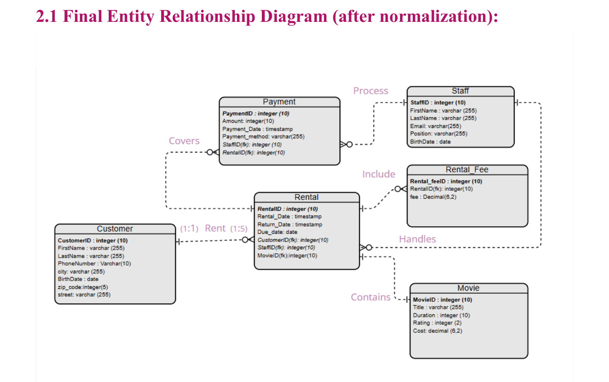

# Movie Rental Store Database

A MySQL-based Movie Rental Store Database developed for the **CS311 – Database Systems** course at **Yanbu Industrial College**.

## Project Overview

This project focuses on designing and implementing a relational database for a movie rental store. The system manages customers, movies, rental transactions, returns, rental fees, staff, and payments.

## Project Objectives

- Manage customer information and records.
- Maintain movie details and availability.
- Track movie rentals and returns.
- Calculate late rental fees.
- Record payments processed by staff.
- Organize data using a normalized relational database.

## Business Rules

- Customers must be at least 18 years old.
- Each customer can have up to 5 active rentals.
- Each movie can be rented for a maximum of 10 days.
- A late fee of 5 SAR per day applies after the due date.

## Entity Relationship Diagram

## Database Design
The database consists of six main entities:

| Entity | Description |
|---|---|
| Customer | Stores customer information. |
| Movie | Stores movie details. |
| Rental | Records rental and return transactions. |
| Rental_Fee | Manages rental fees and late charges. |
| Staff | Stores staff information. |
| Payment | Records customer payments. |

## Database Normalization

The database design applies the following normalization stages:

- **1NF:** Organizes data into atomic values.
- **2NF:** Removes partial dependencies.
- **3NF:** Removes transitive dependencies.

## SQL Implementation

The project demonstrates:

- Database and table creation (DDL).
- Data insertion and manipulation (DML).
- SQL queries for retrieving information.
- Triggers for database operations.
- Aggregate functions for data analysis.

## Project Documentation

- [Project Report (PDF)](CS311_Movie_Rental_Project_Report.pdf)
- [Project Presentation (PDF)](CS311_Movie_Rental_Project_Presentation-compressed.pdf)
- [Database Diagrams](Diagrams/)

## Technologies Used

- MySQL
- SQL
- Relational Database Design
- Entity Relationship Diagrams (ERD)

## Skills Demonstrated

- **Database Design:** Relational database design, ER modeling, and entity relationships.
- **SQL & MySQL:** Database creation, table management, data manipulation, and querying.
- **Database Normalization:** Applying 1NF, 2NF, and 3NF to improve data organization.
- **SQL Programming:** Writing queries, using aggregate functions, and implementing triggers.
- **Data Management:** Managing customer records, movie inventory, rental transactions, and payment records.
- **Problem Solving:** Translating business requirements and rules into a structured database solution.

---

*Academic database project developed as part of the CS311 Database Systems course.*
